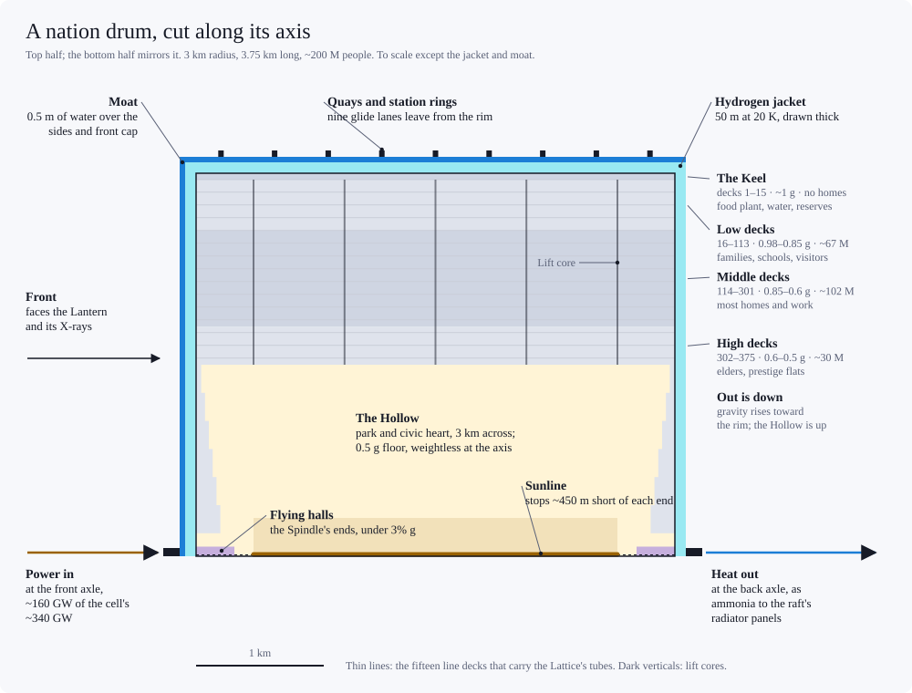

# Standard habitat: the deck drum

*Design proposal from a working session, Sept 2026. Masses are per person and count heavy elements (Z > 2) only; hydrogen and helium are treated as free. In the mature civilization (full-swarm.md), drums fly in rafts in the Shade, outside the Lantern, on beamed power. Revised Oct 2026: there the drum's own water, not an iron parasol, keeps the Lantern's X-rays out of its hydrogen jacket (The moat). Revised again Oct 2026: the nation drum, the baseline, is now 3 km in radius (~200 M people) rather than 2 km (~60 M); raft-habitat.md has the reasons. Revised Oct 29, 2026 after a consistency audit. Revised 1 Nov 2026: per-person metal in the full swarm now counts ~0.3 t of reserves (the tank farm's methanol and liquid oxygen, and ~60 kg of banked survival oxygen, enough for ~100 W; full-swarm.md); the Shade's radiators use the 2 kWe life (~1.9 m² a head) and take the hull's heat in two loops, since 295 K rooms can't cool into 300 K panels without a heat pump; and the "ring era" lines are relabelled as the 10 M☉ design study, since this civilization's ring era was around Sgr A\* (hole-choice.md). Revised 2 Nov 2026 (radiation decisions, Jeff): the jacket's ~20 mSv/yr is the cosmic-ray dose just inside it, and residents behind the moat, Keel and decks take ~1 mSv/yr, least on the Middle decks; the front cap carries ~100 m more hydrogen against an MeV tail in the corona's leak (shields ~3.2 t a person); and the back cap is lined with inside water against the X-ray glow from other rafts (Radiation environment). Revised 6 Nov 2026 (consistency audit): the per-person metal lists the travel shields' ~0.2 t of water and comes to ~6.6–7.6 t against the planning 6.7 t.*

## Assumptions
- Inhabited gravity 0.5–1 g; 100 m² gross floor per person (living, work, circulation, parks).
- Structure: nanocarbon cable/membrane at 10 MJ/kg working specific strength (about a third of theoretical), plus a ×3 allowance over the ideal minimum for real load paths.
- Atmosphere: 21 kPa O₂ + ~80 kPa He (heliox, O₂ ≈ 21% of the mix). Only the O₂ counts against the budget.
- Contents 50 kg/m²: ≈25 for floors/ceilings/services/partitions, ≈25 for furnishings/belongings/greenery. Life support ~0.8 t/person (water ~0.4 t, food bioreactors ~0.35 t; food-system.md estimates the food system at ~0.1–0.2 t).
- Shield: liquid-hydrogen jacket ~3.5 t/m² (~50 m thick) on hull and end caps, plus ~100 m more over the front cap in the Shade (The moat). It holds the Galactic cosmic-ray dose just inside it to ~20 mSv/yr; the moat, Keel and decks bring residents to ~1 mSv/yr (Radiation environment). Rock shielding would need 10–11 t/m² (Globus & Strout). Cryopanels in the guard vacuum between hull and jacket freeze whatever the hull leaks, so the jacket is the drum's cold trap and nothing vents (element-cycles.md).

## Geometry

- Squat cylinder: rim radius R at 1 g; length ≈ 1.25 R. This is passively spin-stable (I_axis/I_transverse ≈ 1.3) and loses its margin past ~1.5 R.
- Concentric decks every 4 m from the rim (1 g) inward to R/2 (0.5 g). Each deck is a self-supporting hoop-tensioned membrane.
- Core (r < R/2): "the Hollow", a pressurized open space. On a raft its zero-g axis holds the sunline, with axle halls for plant at its two ends; docks are at the rim quays (raft-habitat.md). It costs ~50 kg/person.
- Radiator vanes: ~1.2 m² per person per kW at 300 K. The in-hull load is ~1 kW per person in the common case (energy-budget.md), so about 1.2 m² each; heat pumps to run hotter aren't worth their power.
  - Rooms run at ~295 K, cooler than a 300 K radiator, so their heat can't reach one without a heat pump. Instead the hull runs two loops: the rooms' share to radiators at ~283 K, and the food plant's hotter share to ~330 K. That needs about the same area as radiators all at 300 K (raft-habitat.md).
  - In the Shade, radiators work one-sided, on the side away from the Lantern, in the shadow of the raft's front: ~1.9 m² per person for the 2 kWe life's ~0.8 kW hull load (~2.5 m² at the common budget's ~1 kW; full-swarm.md). They are fixed panels in the raft's back layer, fed through a rotary joint at the drum's back cap, not vanes on the hull: spinning vanes would nearly meet their neighbours' and leave no room for the raft's hotter radiators (raft-habitat.md).
- Inner decks face the Hollow's open sky and sit at 0.5 g. Rim decks are deepest, heaviest (1 g), and least shielded, so they suit storage, machinery, and bioreactors. The Middle decks get the lowest radiation dose; the innermost see the end caps across the Hollow, and take about what the Low decks do.
- **On a raft** (full-swarm.md, raft-transport.md), drums stand with their axes toward the Lantern, all spinning the same way. A band round each drum's waist, outside the shield and its moat of water (see The moat), is the quay, where glide cars to and from neighbouring drums are let go and caught. Power comes in at the front cap and heat leaves at the back. The drum's districts and getting around inside it are in raft-habitat.md.

## Sizes (about 6 t/person at every size)
| | Town drum | 2 km drum | **Nation drum (baseline)** | World drum |
|---|---|---|---|---|
| Rim radius / length | 0.5 / 0.6 km | 2 / 2.5 km | **3 / 3.75 km** | 10 / 12.5 km |
| Decks | 63 | ~250 | **~375** | ~1,250 |
| Population | ~0.9 M | ~60 M | **~200 M** | ~7 B |
| Spin / rim speed | 1.3 rpm / 70 m/s | 0.67 rpm / 140 m/s | **0.55 rpm / 172 m/s** | 0.3 rpm / 313 m/s |
| Load-bearing structure | ~70 kg | ~90 kg | **~100 kg** | ~180 kg |
| H₂ in shield (free), with the Shade's thicker front cap | ~19 t | ~4.8 t | **~3.2 t** | ~1.0 t |
| Shield cryocooling (energy-budget.md) | ~100 W | ~25 W | **~17 W** | ~6 W |
| Its water over front cap and sides, full swarm (the moat needs ~50 g/cm²) | ~11 g/cm²: ~1.5 t short | ~51 g/cm² | **~77 g/cm²** | ~260 g/cm² |

- The nation drum was 2 km in radius until Oct 2026. With fast cabs inside (drum-transport.md), a 3 km drum gains reach, shielding and cryocooling, and pays with a smaller Hollow per person and more energy for travel inside (raft-habitat.md).

## Per-person budget (nation drum)
| Item | Mass |
|---|---|
| Floors, ceilings, services, partitions | 2.5 t |
| Furnishings, belongings, greenery | 2.5 t |
| Life support (water, food system) | 0.8 t |
| Oxygen (decks + Hollow) | 0.15 t |
| Structure (hoops, hull, end caps, ties) | 0.10 t |
| Shield tankage | 0.010 t |
| **Total** | **~6 t (≈16 m² per tonne)** |

Rule of thumb: heavy elements per person ≈ 1 t + ~50 kg per m² of floor.
- In the 10 M☉ design study (swarm-rings.md), 6.7 t per person was this drum plus a ~0.67 t share of the ring truss.
- In the full swarm, add ~0.3 t of reserves (the tank farm's ~95 kg of methanol and ~145 kg of liquid oxygen, and ~60 kg of banked survival oxygen), ~0.2 t of water in the travel shields (glide cars ~0.13 t, the tubes and cycler trunks the rest; raft-transport.md, element-cycles.md), ~0.05 t for the person's share of the Lantern, and a raft truss: ~0.05 t on a 0.1 AU raft, up to ~1 t near the ~1.6 AU cap. The cabs (~60 kg; drum-transport.md) sit inside the drum's services line. The drum's water doubles as its X-ray shield (The moat), so there's no iron parasol. That's ~6.6–7.6 t, planned at 6.7 t (full-swarm.md): about right for small rafts, and short by the truss on big ones.
  - The reserves are all carbon and oxygen, mostly oxygen, which white dwarfs supply (matter-delivery.md). Until 1 Nov 2026 the tank farm had no oxygen of its own, and the survival reserve banked only ~35 kg, enough for ~60 W rather than the ~100 W it's meant to carry.

## Alternatives and comparisons
- Rock/slag shield (10 t/m²): 25 t/person at R = 1 km, 16 t at 2 km, 8 t at 10 km, ~7 t at 30 km. Rock-shielded drums should be large.
- Magnetic shield: a toroidal superconducting shell outside the hull, 0.2–0.5 T, with no field inside. About 10–20 kg/person at R = 2 km; stores ~0.4 Mt TNT-equivalent of energy.
- Today's carbon fiber (1 MJ/kg working): structure ~0.9 t/person at 2 km and ~2.4 t at 10 km; impractical by 30 km.
- Open-sky single-floor cylinder (0.5 t/m² landscape): ~60–260 t/person with free shielding, ~1,900 t with rock.

## Life-inside numbers (nation drum)
- A train at 20 m/s along the rim gives 1.25 g spinward and 0.78 g antispinward. A lift with a fixed floor at 5 m/s pushes riders sideways by ~0.06 g; drum-transport.md's gimballed cabs turn that push into a lean.
- Air pressure is 4% higher at the rim than on the 0.5 g decks (3% in a 2 km drum, 16% in a world drum).
- Heliox: sound travels ~1.8× faster, so voice resonances and wind-instrument pitch rise ~10 semitones. Helium chills skin, so habitats run warm.
- Tides: keep drums beyond ~1 million km of a 10 M☉ hole (tidal stretch < 0.001 g). In the Shade, a parsec from Sgr A*, tides are negligible.
- Population ceiling ≈ heavy-element inventory ÷ 6 t (≈10²¹ people per Earth mass of heavy elements).

## Radiation environment
- **The 10 M☉ design study:** hard X-rays leak through the collector tiles at ~170 W/m², so drums carry ~8–10 cm iron parasols on their hole-facing side (xray-power.md).
- **Full swarm (the Shade):** the Lantern takes the disk's ultraviolet, soft X-rays and wind. Only the corona's hard X-rays leak through, ~20–40 W/m² with a median photon energy of ~90–120 keV. The hole's jets are probably switched off in its thin-disk state (full-swarm.md).
  - **The Lantern is a wide source,** 42–65° in half-angle from the Shade. A drum standing in a raft takes 17–29% of the face-on flux on its sides, 0.4–0.7× the X-ray power of its front cap.
  - **For a drum the danger is heat, not dose.** The jacket's 50 m of hydrogen stops every X-ray, but absorbs ~50–65% of what reaches it at 20 K, where each watt costs ~47 W of cryocooling; the rest it scatters back out. With an iron parasol over the front cap alone, the bare sides would cost 30–125 W per person, against the jacket's ordinary ~17 W.
  - So drums in the Shade wear their water as a moat, not iron (below).
- **The corona's MeV tail** (2 Nov 2026). Luminous active nuclei cut their coronae off near ~160 keV, but planning assumes a non-thermal tail carrying ~10% of the leak on to ~100 MeV, as in black-hole binaries' soft states. It barely changes the jacket's heat (below), but it reaches the Hollow through the front cap: without more shielding the front-wall terraces would take ~20 Gy a year. So the front cap carries ~100 m more hydrogen (~700 g/cm², ~1 t a person), keeping homes near it under 1 mGy/yr. The drum turns front-heavy, its spin ratio falling from ~1.30 to ~1.24, still stable. Inner-edge rafts add ~0.7 t a person on the sides.
- **Other rafts throw the leak back.** Rafts farther out face the Lantern and scatter a few percent of the leak outward, so the sky behind a raft glows at ~0.1–0.4 W/m² of 30–100 keV X-rays. Through the bare back cap that costs ~0.4–1.7 W a person of cryocooling, so the back cap is lined with ~30–40 g/cm² of the inside water (~45–60 kg a person), which cuts it under ~0.3 W.

### Cosmic rays and dose (2 Nov 2026)
- **The Galaxy sets the dose, if the hole is quiet.** Near the Centre the cosmic-ray sea is ~1–4× local at the GeV energies that give most of the dose (Fermi-LAT). The hole's own charged particles ride its wind out and lose nearly all their energy; its neutrons would not, so the setting takes a corona that makes few of them as a premise (full-swarm.md, Radiation).
- **The jacket's ~20 mSv/yr is the dose just inside it.** People live behind another ~130–1,900 g/cm² of moat, Keel and decks. At the local sea's strength:

| Where | mSv/yr |
|---|---|
| Low decks | ~0.1–1 |
| Middle decks | ~0.001–0.1 |
| High decks | ~0.05–0.1 (~0.4 just under the Hollow floor) |
| Hollow floor | ~0.4–0.6, through the end caps |
| Back-wall terraces, and homes within ~150 m of the back cap (~4% of residents) | ~2–10 |
| Drum average | ~0.1–1 (Earth's cosmic share: 0.39) |

- **Plan on ~1 mSv/yr** (the sea at ~2×). A 120-year life then takes ~0.12 Sv, ~0.7% more cancer on the linear model, and a generation ~3% more new mutations, which proofreading clears (people.md).
- **"Up is safer" holds only against the rim.** The Middle decks are the quietest homes; the decks just under the Hollow see the end caps across it; the back-wall terraces take the most.

## The moat (full swarm)
- **What it is.** ~51 g/cm² of the drum's own water, held outside the jacket over the sides and front cap: a layer ~0.5 m deep, ~0.26 t per person in the 3 km nation drum, two-thirds of its ~0.4 t of water.
  - The other third (~0.14 t per person, ~27 Mt a drum) stays inside: the Hollow's lake, trim tanks and a reserve that can thicken the moat. A 2 km drum needed all of its water outside.
  - On the sides it's a tank spinning with the drum, pressed against its outer wall at ~1 g (~5 kPa).
  - On the front cap it's a cellular tank, so the water can't run out to the rim.
  - It's the drum's water supply as well, piped across the jacket to the Keel (raft-habitat.md) and through the hull's coolant loop, which holds it near 290 K.
- **What it does,** from photon-transport Monte Carlo across the Shade (Method):

| Front cap + sides | X-ray energy reaching the 20 K jacket | Extra cryocooling per person | New metal per person |
|---|---|---|---|
| Nothing | 50–66% | 115–300 W | 0 |
| 7 cm iron parasol on the front only (first plan) | sides 51–60% | 30–125 W | ~0.08 t |
| Iron: 7 cm front, 4 cm sides | 0.1–1.3% | 0.4–4 W | ~0.2 t |
| **Water moat, ~51 g/cm² (0.26 t)** | **0.1–0.7%** | **0.5–2 W (~1.5–6 W with the MeV tail)** | **0** |
| Water moat, ~44 g/cm² (0.23 t) | 0.2–1.2% | 1–3.5 W | 0 |

- Per-person figures are for the 3 km drum. A 2 km drum has ~1.5× the exposed area per person, so each figure is ~1.5× (its ~51 g/cm² took 0.4 t of water).
- The moat reflects 21–33% of the X-ray energy back out (iron ~5%) and absorbs the rest, 3–8 W per person at ~290 K: about 1% of the hull's heat.
- **Why not hydrogen.** It's dense only as a liquid near 20 K, which is the problem; warm, it's a gas needing tanks heavier than the iron. Venting the boil-off instead would cost ~0.05–0.2 t of hydrogen per person per year: across the civilization, the cluster's whole store of stripped gas within ~100–400 years.
- **Why not iron.** It works, but it's new metal: ~0.2 t per person, ~3% of the 6.7 t. Iron is a tenth of a solar mix of heavy elements, so that's ~30% of each person's share of it, and white dwarfs, the cheapest ore, carry none (matter-delivery.md).
  - Per gram, warm absorbers do the job within ~2× of each other at these energies, because scattering off electrons dominates. Availability decides.
- **Why not shade the whole raft.** A layer across the raft's front would have to cover all ~3 m² per person: ~1.5 t at 50 g/cm², six times the moat, and new mass.
- **Why water.** It's already aboard. Oxygen is the commonest heavy element and comes from white dwarfs too. And it's a liquid, so the coolant loop can carry off its heat and the drum can draw on it.
- **It adds ~15% to the shield's mass** over the front and sides, and with the Keel's tanks and the decks it is part of what brings residents to ~1 mSv/yr (Cosmic rays and dose).
- **Costs.**
  - Radiolysis splits ~0.03–0.08% of the moat a year into hydrogen and oxygen; recombiners turn them back into water.
  - Pipes cross the cold jacket.
  - The water is the armour: a breach costs both, and drawing the moat down raises the jacket's heat load (~44 g/cm² still holds it to a few watts).
- **Drum size.** The moat works where a drum's water covers it to ~50 g/cm², a drum of ~2 km or bigger. The 3 km nation drum's covers it to ~77 g/cm², so a third can stay inside. A town drum's water reaches only ~11 g/cm², ~1.5 t per person short; a world drum needs only a fifth of its water outside.
- **Travellers** between drums need far more: their shields are set by dose, not heat (raft-transport.md).

## Open questions
- How lean interiors are: contents per m² dominates the budget.
- How the inside third of the water (~0.14 t a person) is split between the Hollow's lake (raft-habitat.md), trim tanks and the reserve that can thicken the moat.

## Method (the moat)
- Corona: a power law E^−Γ × exp(−E/E_c), with Γ = 2.0, E_c = 200 keV (soft) or Γ = 1.8, E_c = 300 keV (hard), filtered by ~1.25 g/cm² of Lantern collector (carbon, 10% iron). Leak of 40 W/m² face-on at the Shade's inner edge (Lantern 65.6° in half-angle) and 20 W/m² at its outer edge (41°). From 2 Nov 2026 the planning spectrum is Γ = 2.0 cut off at 160 keV (Ricci et al. 2018's median above 10% of Eddington), plus a tail of 10% of the leak, flat in νF_ν from 0.3 to 100 MeV; the front cap's extra hydrogen and the tail's heat use a slant-path slab with buildup (threads/radiation, radiation_calc.py).
- 1-D slab Monte Carlo, 5 keV–6 MeV: photoabsorption (Elam tables via xraydb, extrapolated above 800 keV) and Klein–Nishina Compton scattering; coherent scattering and pair production ignored. Incidence from a uniform disk source, face-on for the front cap and edge-on for the sides. 300,000 photons per case.
- Geometry at the jacket's outer face, 3 km drum (radius 3,050 m, length 3,850 m): 0.147 m² of front cap and 0.370 m² of side per person (2 km drum: 0.223 and 0.566). Per-person heat loads scale with that area. Jacket 354 g/cm² of liquid hydrogen; cryocooling 47 W per W at 20 K (30% of Carnot).
- Cosmic rays (2 Nov 2026): Globus & Strout's OLTARIS curve for water, the jacket counted as ~6.6 t/m² of water (~20 mSv/yr behind it), attenuated through the moat, the Keel (75–225 g/cm² with its tanks) and 5 g/cm² a deck, for slant and normal incidence (λ ≈ 160–200 g/cm²); the Hollow and High decks through the end caps. Risk: ICRP 103's 5.5% per Sv; germline doubling dose ~1 Gy.
- Aft glow: rafts farther out cover ~1/6 of the sky behind, their fronts lit at 20–30 W/m² and Compton-reflecting a few percent at ~150°; water buildup from Goldstein–Wilkins tables.
- Radiolysis: G(H₂) ≈ 0.45 molecules per 100 eV absorbed. Boil-off: 446 kJ/kg; stripped gas ~2.1 × 10⁷ M☉ shared among ~1.87 × 10³³ people (full-swarm.md; ~1.95 × 10³³ from 1 to 6 Nov 2026, ~1.3 × 10³³ before). Front cap: +700 g/cm² of liquid hydrogen over its 0.147 m² a person ≈ 1.0 t.

## Method (per person)
- Full-swarm reserves, from full-swarm.md's 2 kWe sizing: methanol ~95 kg (~83 kg of it carbon and oxygen), liquid oxygen ~145 kg (1.5 O₂ for each CH₃OH), survival oxygen ~60 kg (with 7.6 kg of shield hydrogen at 55%, ~100 W for 55 days). Heavy elements ~290 kg, ~0.3 t. The CO₂ the tank farm's burn makes is the same carbon and oxygen, stored until refill.
- Shield hydrogen (free, not counted in the metal): ~3.2 t a person in the Shade, ~1 t of it the front cap's extra.
- Total: ~6.0 t drum + ~0.3 t reserves + ~0.2 t travel shields (water) + ~0.05 t Lantern (~4 m² at 10–15 kg/m²) + raft truss (~0.05–1 t).
