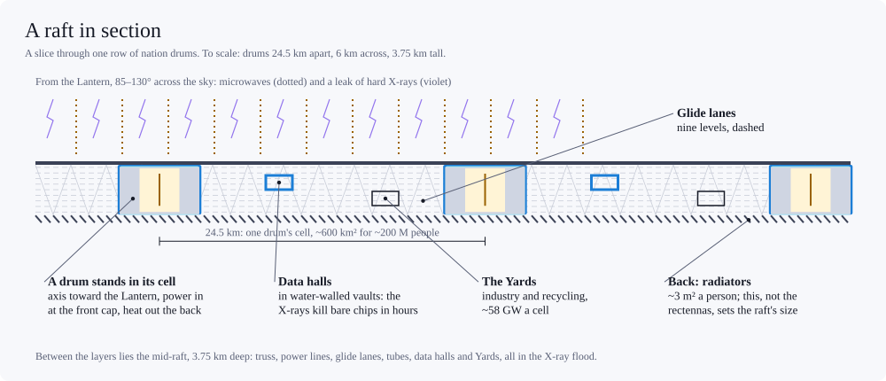
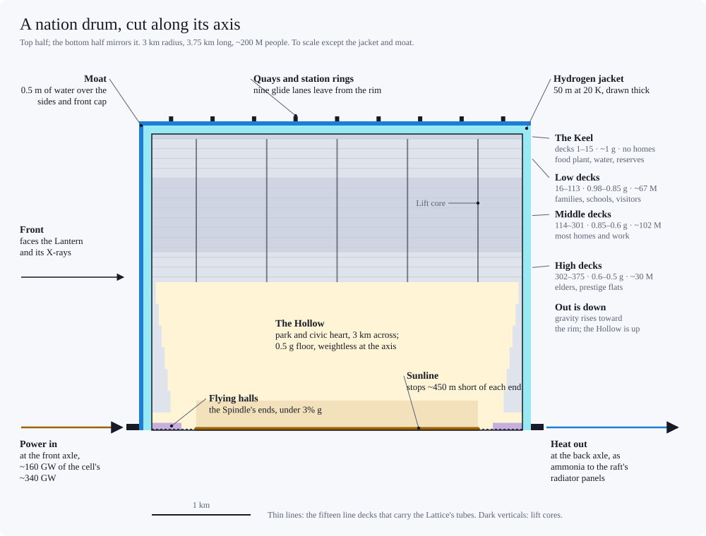

# Raft habitat: a nation drum in the Shade

*Design proposal from a working session, Oct 2026. The drum as a place once it stands in a raft: how big to build it, how it sits in its cell, its districts, and getting around inside it (in full: drum-transport.md). Builds on habitat-design.md (the drum), full-swarm.md (the Shade), raft-transport.md (travel between drums: the Glide, tubes and cyclers) and daily-life.md (the 2 kWe budget, prices and a day on the meter). Power figures use daily-life.md's 2 kWe split, compute included. The names (the Keel, the station rings, the Quaysides, the Spindle, the flying halls) are proposals. Revised Oct 2026: the drum's water is its X-ray shield (habitat-design.md's moat), which sets the smallest drum that works (~2 km); getting around inside now follows drum-transport.md; and the sunline stops short of the end walls, so the Spindle can be flown by day. Revised again Oct 2026: the nation drum is now 3 km in radius and ~200 M people (Drum size on a raft); figures are for that drum unless marked. Revised Oct 29, 2026 after a consistency audit.*

## Summary
- **The nation drum is 3 km in radius, 3.75 km long, ~200 M people.** It was 2 km and ~60 M until Oct 2026.
  - Fast cabs inside (drum-transport.md) removed most of what a bigger drum cost, and counted in people, a bigger drum reaches more by Glide, not fewer.
  - It needs a third less shield hydrogen, and its water covers it with a third to spare.
  - The price: a smaller Hollow per person, longer trips inside the hull and to the next drum, and more energy for cabs.
- **On a raft, the density of people, not of mass, decides drum size.**
  - The raft's ~2,950 kg/m² is ~99% drums and their hydrogen, standing on ~5% of its area; the sheet between weighs tens of kg/m². Drum size moves it mainly through the hydrogen: 2 km drums would raise it to ~3,300 kg/m², town drums would more than double it and cut the raft's self-gravity cap from ~1.6 AU to ~0.65, and world drums would cut it by a sixth.
  - People do constrain it. At ~3 m² each, a drum of N people owns a cell of ~3N m², and its neighbours sit √(3N m²) away. Nation drums are 24.5 km apart, a free 140-second glide (raft-transport.md).
  - So the drum stops being the unit of community. The raft supplies scale (~1.6 × 10¹⁰ people within 20 minutes by Glide); the drum is sized for life inside one hull, and a bigger hull keeps more of daily life inside.
- **A raft picks one size.** Drums glide only to drums with the same rim speed.
- **Three ports:** power comes in at the front cap, heat leaves at the back cap, and people and goods leave at the rim.
- **The drum wears two-thirds of its water as a moat,** ~0.5 m deep outside its hydrogen jacket on the sides and front cap, in place of an iron parasol. The Lantern's hard X-rays flood the mid-raft from a source up to 130° across, and the moat keeps their heat out of the 20 K jacket (habitat-design.md).
- **Radiators are fixed panels across the raft's back,** fed through a rotary joint at the back cap. At 2 kW they fill the cell's back, and that, not the rectenna (~2 m²), sets the raft at ~3 m² per person. Radiator vanes spinning with the drum wouldn't leave room for the hotter loads.
- **Districts are bands of gravity:** the Keel (rim, ~1 g: food plant, reserves and the drum's stations), the Low, Middle and High decks, and the Hollow (0.5 g floor, open sky). Out is down; the Hollow is up.
- **The sunline stops ~450 m short of each end wall.** Within ~500 m of a full-sun line, its light alone outdoes Earth's noon sun (~6.7 kW/m² at the Spindle's 75 m edge). So by day people fly only in the flying halls at the Spindle's two ends, and the rest of it opens in the lamp-night.
- **Each deck is a city** of 350,000–700,000 people, 9–19 km around and 3.75 km wide; a drum stacks ~375 of them.
- **A glide is the one time most people see outside:** 140 seconds of weightless flight through the mid-raft, a dark hall 3.75 km deep with drums standing in it like squat pillars.

## Drum size on a raft
### How much raft a person needs
At daily-life.md's 2 kWe (1.70 kWe beamed, 0.30 of batch compute on the Lantern):
- **Front:** ~1.95 m² of rectenna (1.70 kWe × 1.03 margin ÷ 90% rectenna, at ~1 kW/m² of microwaves), plus ~0.15 m² of drum cap behind the moat's front tank.
- **Back:** ~1.9 m² of 300 K radiator for the hull's 0.80 kW (one-sided), ~0.65 m² at 350 K for the data halls' 0.50 kW, and a few tenths more, running hotter, for the Yards, rectenna losses and track losses: ~2.8–3.2 m² in all.
- **So the back sets the raft at ~3 m² per person,** ~2,950 kg/m². Near the Shade's inner edge, Lantern glow reflected off outer rafts' fronts adds ~10–30% to radiator loads, so inner rafts take ~3.3–3.6 m². The common budget needs ~3.5 m² on the back (see Open questions).

### What changes with drum size
At 2 kW and 3 m² per person:

| | Town (R 0.5 km) | R 2 km | **Nation (R 3 km)** | World (R 10 km) |
|---|---|---|---|---|
| People | 0.9 M | 60 M | **200 M** | 7 B |
| Neighbour | 1.7 km | 13.4 km | **24.5 km** | ~150 km |
| Glide hop | 22 s | 93 s | **140 s** | ~8 min |
| Next drum, door to door | ~5 min | ~7 min | **~8½ min** | ~17 min |
| People within 20 minutes / an hour, by Glide | ~3 × 10⁹ / ~4 × 10¹⁰ | ~1.1 × 10¹⁰ / ~1.5 × 10¹¹ | **~1.6 × 10¹⁰ / ~2.2 × 10¹¹** | ~5 × 10¹⁰ / ~7 × 10¹¹ |
| A random trip inside, mean / worst (drum-transport.md) | ~4 / ~6 min | ~5 / ~9 min | **~6 / ~12 min** | ~12 / ~25 min |
| Innermost deck to the rim, by cab | 0.5 min | 1.1 min | **1.5 min** | 2.4 min |
| Hollow floor per person | ~1.1 m² | 0.27 m² | **0.18 m²** | 0.05 m² |
| Shield hydrogen | 13 t | 3.3 t | **2.2 t** | 0.7 t |
| Its water over front cap and sides (the moat needs ~50 g/cm²) | ~11 g/cm²: ~1.5 t short | ~51 g/cm² | **~77 g/cm²** | ~260 g/cm² |
| Load-bearing structure | ~70 kg | ~90 kg | **~100 kg** | ~180 kg |
| Shield cryocooling | 100 W | 25 W | **17 W** | 6 W |
| Raft areal density | ~7,100 kg/m² | ~3,300 kg/m² | **~2,950 kg/m²** | ~2,500 kg/m² |

- **Small drums lose on shielding.** Jacket, moat and cryocooling all scale as 1/R. A raft of town drums would put ~40% of the cluster's stripped gas into shields instead of ~7%, need ~1.5 t more water per person to fill out the moat, more than double the raft's areal density, and spend 5% of a 2 kW budget keeping hydrogen cold.
- **Big drums gain reach.** People per km² of raft are fixed (~3 m² each) whatever the drum size, and a bigger drum's quay moves faster, as the square root of its radius. So the Glide covers more raft per minute, and the people within a given glide time grow with drum size, though each hop is longer.
  - *An earlier version of this doc said big drums lose on reach. It counted hops, not people.*
- **What big drums lose:**
  - **Short trips.** The next drum is farther, and a big drum takes longer to cross: ~12 minutes on average in a world drum, ~25 at worst. Cabs make the climb cheap: at about a seventh of rim speed (drum-transport.md), a world drum's innermost decks are 2.4 minutes from the rim, not the 7.6 a fixed-floor lift would take. But they can't shorten the distance. Air pressure differs 16% across a world drum's decks, so its cabs need pressure control.
  - **The Hollow, per person.** It shrinks as 1/R: the floor grows as R², the people as R³.
  - **Energy for travel inside.** Trips inside the drum pay drag, and the Glide costs nothing, so a bigger drum moves travel from the free Glide into its cabs: ~4–7 W per person in a 2 km drum, ~7–12 W in a 3 km one (drum-transport.md).
- **Why 3 km.** With the moat there's no iron left to save. The trade is the Hollow and short trips on one side, reach, shielding and cooling on the other.
  - Against a 2 km drum, the 3 km drum needs a third less shield hydrogen (2.2 t a person) and ~8 W less cryocooling per person. Its water covers it with a third to spare, enough for a lake, and ~45% more people are within 20 minutes by Glide.
  - The price is a Hollow a third smaller per person, trips inside ~1 minute longer on average, ~3–5 W more for cabs, ~10 kg more structure per person, and 140 s glides.
  - Bigger drums would push the same trade further and keep less of the Hollow; 3 km keeps two-thirds of it per person.
  - The choice is made per raft, not per drum (raft-transport.md: drums glide only to drums with the same rim speed).

## How a drum sits in its cell

- **The cell.** A nation drum owns ~600 km² of raft, a square ~24.5 km on a side (raft-transport.md's grid, set by the Glide's lanes).
- **The layers** (raft-transport.md): rectennas in front, radiators behind, and 3.75 km of mid-raft between them. The drum stands in the mid-raft with its axis toward the Lantern: front cap in the rectenna layer behind the moat's front tank, back cap at the radiator layer, rim in the raft's plane.
- **Three ports.**
  - **Front cap: power in.** The cell's rectennas deliver ~340 GW; ~160 GW of it enters the drum through a rotary joint at the front axle, at the hub of the moat's front tank.
  - **Back cap: heat out.** The hull's ~160 GW leaves as coolant through a rotary joint at the back axle: ~130,000 kg/s of two-phase ammonia, ~220 m³/s of liquid, a river's worth. The back axle is also the service dock for the radiator layer.
  - **The rim: people and goods.** Every trip to another drum starts and ends at a quay outside the jacket and moat (raft-transport.md). The axis is no longer the drum's front door.
- **Radiators are fixed panels, not vanes.** At 2 kW the hull alone needs ~390 km² of one-sided 300 K radiator.
  - As an annulus spinning with the drum, it would reach ~11.5 km from the axis, against 12.2 km to the cell's edge. That leaves only the cell's corners (~0.65 m² per person) for ~0.9–1.3 m² of hotter radiators. At the common budget the annuli (~12.9 km) would overlap their neighbours'.
  - Fixed panels can tile the whole back: ~390 km² at 300 K for the hull, the rest hotter for the data halls, Yards and rectenna losses.
- **The mid-raft between drums** holds the truss, power lines, the Glide's lanes and tubes, the data halls (interactive compute, ~100 GW per cell) and the Yards (industry and recycling, ~58 GW per cell). Their heat goes to hotter panels in the back layer.
  - The mid-raft is an X-ray flood: silicon takes ~2–15 MGy a year there, which kills ordinary chips in hours and hardened ones in months. So data halls, inverters and controllers sit in water-walled vaults (~1.5 t/m² of wall, ~0.1–0.5 kg per person). Rectennas, which face the Lantern, use diamond or GaN diodes and are replaced on a schedule.
- **The shell.** 50 m of liquid hydrogen at 20 K (~450 Mt), kept cold by ~3.4 GW of cryocoolers. Outside it, the moat: ~53 Mt of the drum's ~80 Mt of water, ~0.5 m deep over the sides and front cap, which keeps the Lantern's X-rays out of the jacket and reflects a quarter to a third of them back into the mid-raft (habitat-design.md). The rest is inside: the Hollow's lake, trim tanks and a reserve.
- **The view.**
  - A glide is the one time most people see outside: 140 seconds of free flight through the mid-raft, a dark hall 3.75 km deep between the rectenna and radiator layers, flooded with the Lantern's hard X-rays.
  - Through windows on the side away from the Lantern, a metre of clear water thick (raft-transport.md), passengers see the radiator layer's underside. Drums stand between the layers every 24.5 km, 6 km across and 3.75 km tall, in rows that run to a vanishing point.
  - There are no stars; the raft's layers hide the sky. Only crews on the back of the raft see stars, with other rafts as starless patches. Nobody sees the Lantern.

**Per drum at 2 kW** (200 M people):

| | |
|---|---|
| Delivered at the raft | ~340 GW |
| Into the hull | ~160 GW |
| Data halls / Yards / travel | ~100 / ~58 / ~20 GW |
| Batch compute, on the Lantern | ~60 GW |
| Hull radiators (300 K, one-sided) | ~390 km² |
| Cryocoolers | ~3.4–3.8 GW (the moat's leak is the extra) |
| Shield hydrogen / water | ~450 Mt / ~80 Mt (~53 Mt of it in the moat) |
| Banked oxygen | ~7 Mt |

## Districts

| Band | Gravity · residents | Mostly |
|---|---|---|
| The Keel (decks 1–15) | ~1 g · no homes | Food plant, water, reserves, station rings |
| Low decks (16–113) | 0.98–0.85 g · ~67 M | Families, schools, sport, visitors |
| Middle decks (114–301) | 0.85–0.6 g · ~102 M | Most homes and workplaces |
| High decks (302–375) | 0.6–0.5 g · ~30 M | Elders, prestige flats |
| The Hollow (r < 1.5 km) | 0.5 g floor, 0 at the axis | Park, civic heart, the sunline |

- **The Keel** is the drum's metabolism and its front door, ~5 m² of floor per person.
  - It holds the food plant (Mill, Vats, Garden racks; food-system.md), the water works (two-thirds of the water itself is stored in the moat, outside the jacket), the methanol tank farm (granary and battery), the survival reserve (~7 Mt of banked oxygen and fuel cells), waste oxidation, recyclers and workshops.
  - **Station rings.** Platforms ring the rim deck under each lane level's quay (~9 along the drum's length; raft-transport.md). Cars pass out through the jacket and moat to the quay's cradles, which carry them round to their lane's touch point.
  - **The Quaysides,** the blocks around the station rings, are the busiest in the drum: markets, freight, and quarantine for anything biological, since here a phage is a famine.
  - The Keel has no homes: the rim decks are the least shielded against cosmic rays (habitat-design.md).
- **Low decks.** Nearest the stations and the heaviest gravity: commuters, inns for visitors. If growing skeletons want near-Earth gravity (nobody today knows the dose–response), this is also where children are raised and athletes train.
- **Middle decks.** Most of the drum's homes and work.
- **High decks.** The lowest radiation dose, the lightest step and the shortest walk to the Hollow make them the prestige address, though they're the farthest from the stations. The old live here too: a fall at 0.55 g carries about half the energy of one on Earth. Money lives up; the way out is down.
- **The Hollow.** 3 km across and 3.75 km long, a quarter of the drum's volume. Its floor is the innermost deck: ~35 km² at 0.5 g, 0.18 m² per person, a third less than in a 2 km drum.
  - A sunline along the axis holds full-sun brightness for ~6 hours around midday at 2 kW, ramping over 3 hours either side (daily-life.md), or 12 full hours at the common budget. It stops ~450 m short of each end wall (see The sunline and the Spindle).
  - The far bank hangs 3 km overhead and looks sharp: filtered heliox carries no dust and scatters very little.
  - Terraced end walls climb toward weightlessness.
  - A lake needn't draw on the moat. One over a tenth of the floor, 2 m deep, takes ~0.035 t per person (~7 Mt), a quarter of the water the drum keeps inside.
- **The Spindle.** The axis itself. Within ~75 m of it you weigh under 3% of a g: flying country, though by day only in the flying halls at its two ends, since the sunline runs down its middle. Flight along the axis is easy; crossing it, Coriolis bends your path. The axles at its two ends are plant: power in at the front, coolant out at the back.

### The sunline and the Spindle
- **A full-sun line is too bright to fly beside.** The floor's 100,000 lux, 1.5 km from the axis, is ~330 W/m² of light: as bright as noon on Earth but a third of the power, since lamps send no infrared. A line's light falls off only as 1/distance:

| Distance from the line | Light on a surface facing it | For comparison |
|---|---|---|
| 1,500 m (the floor) | ~0.33 kW/m² | A third of Earth's noon sunshine |
| 500 m | ~1.0 kW/m² | Earth's noon sunshine |
| 300 m | ~1.7 kW/m² | About the most skin takes for long |
| 75 m (the Spindle's edge) | ~6.7 kW/m² | Painful within seconds; burns within a minute |

- **So the lit line stops ~450 m short of each end wall.** It hangs on a tensioned spar from axle to axle, and the last ~450 m at each end are bare spar.
  - **The flying halls** fill the Spindle's ends: within 75 m of the axis, from each end wall out to ~300 m, netted off ~150 m short of the line's end. A surface there facing the line's end gets at most ~0.45 kW/m², a bright morning, and less near the axis, since a line barely shines along itself. The rest is the Hollow's own glow, ~50–80 W/m² (15,000–25,000 lux) if the floor and walls reflect 15–25%: a bright overcast day.
  - **The middle of the Spindle opens** when the line is under ~14% of full brightness (≤1 kW/m² at 75 m): the last ~25 minutes of dusk, the lamp-night and the first ~25 minutes of dawn, about 13 hours a day on daily-life.md's schedule. Flying its whole length is a night thing.
  - **Spindle lifts** (drum-transport.md) climb the end walls to the axis and arrive in the flying halls, clear of the line.
- **What it changes:**

| | Full-length line (3.75 km) | Stops 450 m short (2.85 km) |
|---|---|---|
| Light per metre, for the same brightness mid-floor | 1 | ~1.1 |
| Power at full sun | ~14 GW | ~12 GW (−16%) |
| Floor at the foot of an end wall, against mid-floor | ~55% | ~38% |
| End-wall terraces 750 m from the axis | ~0.33 kW/m² | ~0.14 kW/m² |
| Top terraces, 150 m from the axis | ~1.7 kW/m², past Earth's noon | ~25 W/m² direct, plus the Hollow's glow |
| Share of the light landing on the end walls | ~24% | ~19% |

- **The floor's ends get a dusk, and the end walls gentler light.** The floor's last ~750 m before each wall dims toward it, and the terraces get about 40% of their old light. The top terraces, which a full-length line would scorch, become gardens.
- **Budget.** The Hollow's sky costs ~22 W per person for daily-life.md's 6 hours of full sun. A 2 km drum, with half as much again Hollow per person, takes ~33 W with this shortened line, and took ~39 W with the full-length line daily-life.md first priced. daily-life.md gives the ~17 W saved against that first price to parks.
- **The line needs its own cooling.** At 250 lm/W, against ~300–320 lumens per watt of light, ~20% of its power is heat in the fixture: ~2.4 GW at full sun. Its spar carries coolant to the back axle, as it carries power from the front one.
- **Alternatives:**
  - Fly the Spindle only in the dim hours, with no flying halls by day. Simplest.
  - A fat light tube instead of a line. To keep its surface under Earth's noon sunshine it would need a radius of ~500 m, filling the middle of the sky and hiding much of the far bank.

## A deck up close
- Deck 201, mid-drum at 0.73 g, is 13.8 km around and 3.75 km end to end, with ~520,000 people. The rim deck is 18.8 km around, the innermost 9.4 km.
- Decks are 4 m apart, so ceilings are ~3 m. Most of the drum is an indoor city of streets and arcades. The Hollow and the atria, parks cut through several decks, are the only ceilings higher than a room.
- **Each person's 100 m² of floor:** ~35 m² of home, 15 of workplace, 15 of schools, clinics, shops and halls, 25 of streets and lift lobbies (the cab network's cores and line decks take ~11 of these; drum-transport.md), 5 of parks and 5 of Keel. At 2 kW, ~2.6 m² per person of park is lit to overcast daylight, or ten times that at 1,000 lux (daily-life.md); the rest is lit like a room.
- **Streets.** Avenues run spinward and streets along the axis, crossing them. Both are for walking and cycling; the fast lines run in tubes on fifteen line decks, each two decks deep, one in every 25 decks (drum-transport.md).
- **Lift cores** stand every ~100 m and run through all ~375 decks, each serving ~38,000 people through ten cab channels, like the cores of a supertall tower. They converge slightly toward the Hollow.

## Getting around inside
*Revised Oct 2026: drum-transport.md designs this in full, replacing the first sketch (lifts at ~5 m/s, avenue trams at 8 m/s), and sizes it for a few journeys per person a day. Revised again for the 3 km drum.*
- **One cab, door to door.** Cabs with gimballed cabins run radially in the lift cores at 20 m/s and horizontally in helium-filled tubes on the line decks at up to 30 m/s. They stop only at berths off the line, so nobody changes vehicles inside the drum.
- **Between decks:** a lift with a fixed floor is capped at ~6 m/s here (the sketch's ~5 m/s, in a 2 km drum). A cabin that tilts turns the Coriolis push into a lean, so the innermost deck is ~1½ minutes from the Keel.
- **Around the drum, weight still changes with direction.** Spinward is heavier, so each loop posts two speed limits, ~18–30 m/s depending on direction and depth. Along the axis nothing changes.
- **Times:** any two points are ~6 minutes apart door to door on average and ~12 at worst. A station platform is ~2 minutes from an average flat, and a neighbouring drum ~8½ minutes door to door.
- **Capacity:** built for a few journeys each a day, ~90 M rides an hour per drum at the peak, more than twice a day's traffic on all of Greater Tokyo's railways. Most stay inside: the Glide can take ~45% of residents out and back each day. Cabs carry one party each (~1.4 riders) and couple into platoons on the trunks. Each core has ten channels, the line decks run two pairs of loops along every row of cores, and each station ring is a station four decks deep. ~6–9 M cabs, ~11 m² of floor and ~60 kg of metal per person.
- **Energy:** ~7–12 W per person depending on the day, mostly drag, or ~5–8 W if most trips stay local. That's inside the 20 W line for lifts and in-drum trams (daily-life.md, energy-budget.md), paid for by the bigger drum's saving on cryocooling.
- **Freight** rides the same cabs off-peak. At 2 kW the Yards remake ~100 kg per person a year (daily-life.md), ~20 Mt a drum, in and out through the Quaysides.
- **Emergencies.** Any cab can be an ambulance, with a stretcher level on its gimballed floor. In the Dark the Glide keeps running on almost no power, so neighbouring drums can pool food and parts (raft-transport.md), and the cabs run on rations, ~2 W per person.

## Life inside
- **Air.** Heliox: warm rooms, voices with higher formants, wind instruments ~10 semitones sharp, food that cools fast (habitat-design.md).
- **Weight is a map.** It varies by deck and by direction of travel, and a cup knocked off a table lands ~2 cm antispinward.
- **The Hollow is scarce.** If 0.7% of the drum is there on a busy afternoon, each person has ~25 m², a crowded beach. Expect Hollow time to be booked, rotated by deck, or fought over.
- **Social geography.** The rich live up, near the Hollow; commuters live down, near the stations; the plant and the stations share the bottom.
- **Polities.**
  - A drum is a nation of ~200 M, and the ~1.6 × 10¹⁰ people within a 20-minute glide are a metropolis of drums.
  - A raft is a world, and it holds the beam contract with the Lantern. Each drum holds its own 55-day reserve.
  - A raft must pick one drum size to glide, so its size standard is a founding political fact.
  - What sits above the raft, and who holds the Lantern, is in governance.md.

## Knock-on changes
- **habitat-design.md:** a pointer here, and in the Shade radiators are fixed panels in the raft's back layer, fed through the back cap, rather than vanes. Oct 2026: the moat replaces the iron parasol.
- **daily-life.md, energy-budget.md:** this doc uses their numbers. Oct 2026: both revised for the 3 km drum (cryocooling, the Hollow's sky, cabs).
- **raft-transport.md, full-swarm.md:** Oct 2026, travellers' shielding and the moat (see those docs).
- **The sunline (Oct 2026):**
  - daily-life.md: its Hollow's sky is now priced for this line (~22 W per person in the 3 km drum).
  - drum-transport.md: its Spindle lifts arrive in the flying halls.
  - habitat-design.md: its zero-g axis "for docks and industry" now means the axle halls at the two ends; the middle of the axis is the sunline's.
  - ashgrove.md already uses this layout.
- **drum-transport.md:** Oct 2026, replaces this doc's lifts and trams with cabs; the drum-size table and the big-drum bullets use its cab speeds. Later sized for capacity: ten channels per core, line decks two decks deep. Revised again for the 3 km drum: ~7–12 W per person.
- **The 3 km baseline (Oct 2026):** habitat-design.md, drum-transport.md, raft-transport.md, full-swarm.md, energy-budget.md, daily-life.md, economy.md, governance.md, element-cycles.md, sgr-a-scope.md, swarm-rings.md, xray-power.md, matter-delivery.md and ashgrove.md now use the 3 km drum.

## Open questions
- The back-cap rotary joint: ~160 GW of heat, ~220 m³/s of ammonia, turning at 0.55 rpm.
- Settled Oct 29, 2026: rafts are built at 3 m² per person, for the 2 kWe life. At the full common budget the back would need ~3.5 m² of radiator per person even with the hot loads at 400–600 K, so a raft living that well is built roomier, or runs its Yards and rectennas hotter.
- How many station rings, and whether the Quaysides belong to the Keel or the Low decks.
- How much gravity children need.
- Who gets the Hollow, and when.
- How far short of the end walls the sunline stops. 450 m buys flying halls ~300 m long; more lengthens them and dims the floor's ends further.
- A lake in the Hollow: how much of the drum's spare water to give it, and what 0.5 g does to its waves.
- How much of daily life stays inside a drum of 200 M. Cabs are sized for random destinations, the worst case.

## Method
- Drum: rim 3,000 m at 1 g (ω = 0.0572 rad/s), length 3,750 m, decks every 4 m from 3,000 m to 1,500 m (376 decks), 100 m² per person: ~199 M (200 M nominal). Deck floor = 2πrL. Bands by deck number from the rim; residents in proportion to floor, the Keel (decks 1–15, ~5 m² a person) excluded. Other sizes keep length = 1.25 R; the 2 km drum is R = 2,000 m, L = 2,500 m, ~59 M.
- Cell = people × 3 m²; square pitch = √cell (raft-transport.md). Footprint = πR² ÷ cell.
- Radiators, one-sided at emissivity 0.9: 413 W/m² at 300 K, 766 at 350 K, 1,306 at 400 K. Hull 0.80 kW at 300 K; data halls 0.50 kW at 350 K; Yards 0.29 kW, rectenna losses (10% of ~1.95 kW of microwaves) and track losses (~0.1 kW) at 350–600 K. Rectenna = 1.70 kWe × 1.03 ÷ 0.9 at ~1 kW/m².
- Spinning-vane annulus: π(r_out² − R²) = hull radiator area.
- Shielding: hydrogen at 3.5 t/m² over hull and caps; each drum's 0.4 t of water per person spread over its front cap and sides, at the jacket's outer face (R + 50 m, length L + 100 m), topped up to ~50 g/cm² where that falls short (habitat-design.md); the 3 km drum keeps ~51 g/cm² (0.26 t) outside. Structure interpolated from habitat-design.md (~70 / 90 / 100 / 180 kg at R = 0.5 / 2 / 3 / 10 km). Areal density = (6.6 t + extra water + structure difference + hydrogen) ÷ 3 m². Self-gravity cap ∝ 1 ÷ areal density.
- Shield gas: hydrogen per person × 1.27 × 10³³ people, against the cluster's ~2.1 × 10⁷ M☉ of stripped gas (full-swarm.md).
- Glide hop = pitch ÷ quay speed, with the quay at R + 50 m (raft-transport.md). Reach: raft-transport.md's formula with each size's cab rides and quay waits (quay waits scale with the drum's turn). Trips inside, next drum and reach come from drum-transport.md's model run at each radius, with random destinations.
- Hollow per person: 2π(R/2)L ÷ people, ∝ 1/R.
- Lifts: cabs at tan 30° × rim speed ÷ 4 (10 / 20 / 45 m/s in town, 2 km and world drums) and 1.5 m/s², per drum-transport.md. The 3 km drum's cabs run at 20 m/s rather than the 25 that allows, since 25 saves only ~3 s on an average ride. A fixed-floor lift would be capped at 0.07 g ÷ 2ω (6.0 m/s in the 3 km drum, 4.9 in a 2 km one). Weight on a deck at speed v: × (1 ± v ÷ ωr)².
- Sunline: a thin line on the axis, shining like a diffuse cylinder. 100,000 lux on the floor is ~333 W/m² of light at ~300 lumens per watt of light; beside the line, light ∝ 1/distance (~7.3 kW/m² at 75 m with the shortened line's ~10% more per metre). From a line between z₁ and z₂, light at radius ρ and axial position z, relative to an infinite line's at the floor (π/(2 × 1,500 m)): on surfaces facing the axis ∝ ρ²∫dz′ ÷ (ρ² + (z′ − z)²)²; on surfaces facing the line's end ∝ (ρ/2)[1/(ρ² + (z₁ − z)²) − 1/(ρ² + (z₂ − z)²)]. A full-length line sends ~76% of its light to the floor and gives its middle ~88% of an infinite line's brightness; daily-life.md's lumens-over-area figure leaves out the end walls. Ramps as daily-life.md, taken as linear. Light scales with the drum: at matching points (all distances × 1.5) it's the same as in a 2 km drum.
- Spar: a line held on the axis by tension stays there if the tension per kg of line exceeds ω²(L/π)², ~4.7 kJ/kg, trivial for nanocarbon.
- Light tube: surface flux = 333 W/m² × 1,500 m ÷ tube radius.
- Hollow lighting: 100,000 lux over 35.3 km² at 250 lm/W.
- Dropped objects: straight-line flight in the non-rotating frame, from 1 m.
- Coolant: 160 GW ÷ 1.2 MJ/kg (ammonia's latent heat), liquid at ~600 kg/m³.
