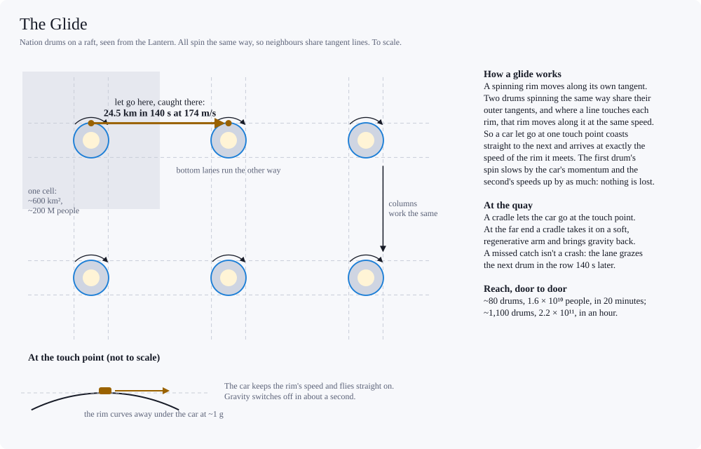

# Raft transport: getting around inside a raft

*Design proposal from a working session, Oct 2026. Travel between drums on one raft in the Shade (full-swarm.md): nation drums (habitat-design.md) on compact rafts at ~3 m² per person. Seat masses and the 1 g, 20 km/s express come from energy-budget.md; prices are in kWh, as in daily-life.md. The names (the Glide, quays, the tubes, cyclers) are proposals. Travel between rafts is out of scope. Revised Oct 2026: travellers' X-ray shielding is sized for dose, not heat, and drums' sides are shielded by their own water (habitat-design.md). Revised again Oct 2026: the nation drum is now 3 km in radius and ~200 M people (raft-habitat.md), so drums stand farther apart and glide faster. Revised Oct 29, 2026 after a consistency audit.*

## Summary
- **A raft is about the easiest place there is to move things.** It's vacuum, nearly weightless (~10⁻⁶ m/s² from its own mass), and turns only once per 39,000-year orbit, so a moving car keeps moving. Energy goes only into speed, and most of it comes back at the brake. Nothing drags; every loss is a conversion.
- **The hazard is X-rays, from every side.** The Lantern's hard-X-ray leak (~20–40 W/m²) gives an unshielded person a lethal dose within minutes, and the radiator layer and the drums' moats scatter it back from behind.
  - Glide cars carry closed shells of sealed water, ~1–2 t/m², ~5 t per seat. Powered cars run in shielded tubes.
  - Per gram, water stops the corona's hardest photons better than iron, so no iron is needed. Polyethylene would too, but X-rays split hydrogen out of it, which the swarm can't spare (element-cycles.md).
- **Three tiers:**
  - **The Glide.** Drums let cars go from their rims and catch them on neighbours' rims, along straight lanes that graze both. It's free: the drums' spin does the work and gets it back. ~140 s per drum at 174 m/s.
  - **The tubes.** Shielded tubes along every row and column of drums, with linear motors, for trips of minutes to a day at up to 20 km/s.
  - **Cyclers.** Sleeper trains that never stop, looping on trunk tubes across the raft. Passengers board and leave by capsule, so only ~200 kg per traveller is ever sped up or slowed.
- **Efficiency.** Plan on losing ~1% of a car's peak kinetic energy per trip, against energy-budget.md's 3%. ~0.3% if every conversion reaches ~99.9%. Today's best big converters and generators would lose ~5%.
- **Prices at 1%:** a 400 kg seat costs ~0.56 kWh × (top speed in km/s)², a cycler capsule ~0.28. daily-life.md's express leg (667 kWh at 3%) becomes ~220 kWh by tube or ~110 by cycler; its 2-kW travel year falls from ~840 kWh to ~210.
- **Reach, door to door:** free glides reach ~1.6 × 10¹⁰ people in 20 minutes and ~2.2 × 10¹¹ in an hour. Tubes reach ~1.5 × 10¹² in 20 minutes (~8 kWh), ~4 × 10¹⁴ in an hour (~135 kWh) and ~2 × 10¹⁸ in a day (~220 kWh).
- **Side effects:**
  - The Glide runs through the Dark on almost no power.
  - Fast cyclers are a raft's biggest store of energy, and can be braked a little at a time to stretch a beam cut.
  - Travel no longer argues for small rafts; the truss's metal does.
- **Layout assumed:** drums stand with their axes toward the Lantern, all spinning the same way.
- **Drum sides,** the problem this doc first turned up (the Lantern is a wide X-ray source, so a drum's sides take ~0.4–0.7× the X-ray power of its front), are settled in habitat-design.md: a drum's own water shields them (the moat).

## Setting

- **Spacing.** At ~3 m² per person, a nation drum (~200 M) gets ~600 km² of raft: drums ~24.5 km apart on a square grid. A 0.1 AU raft holds ~6 × 10¹⁹ people (~3 × 10¹¹ drums); the ~1.6 AU cap ~1.5 × 10²² (~7 × 10¹³ drums).
- **Drums stand,** axis toward the Lantern, their water in a moat over the front cap and sides (habitat-design.md). Rims lie in the raft's plane.
- **All drums spin the same way,** so neighbours share tangent lines (below). The raft's net spin is harmless: turning each drum once per orbit, to keep facing the Lantern, takes ~3.5 × 10⁶ N·m.
- **Layers.** Rectennas in front, radiators behind. Between them lies ~3.75 km of mid-raft, the drums' length: truss, power lines and lanes.
- **Forces on a free car,** all tiny:
  - the raft's own gravity, ~1.2 × 10⁻⁶ m/s² toward its mid-plane and ~2 × 10⁻⁷–1 × 10⁻⁶ in the plane, toward its centre;
  - Coriolis from the raft's slow turn, ~2–4 × 10⁻⁷ m/s² at 20–40 km/s;
  - the hole's tides, under 10⁻¹¹ m/s² across an AU.
  - Over a 140 s glide that's about a centimetre. Over a week's cruise it's tens of km, so the tubes steer (see The tubes).
- **X-rays.**
  - 20–40 W/m² of photons with a median energy of ~90–120 keV gives ~0.1–0.3 Gy/s at the skin: a lethal dose within minutes. The rectennas in front are thin, so it floods the mid-raft.
  - The Lantern fills 13–29% of the sky (42–65° half-angle), so a shield must cover every direction within ~65° of it. A surface edge-on to the Lantern still gets 17–29% of the face-on flux.
  - **Behind matters too.** The radiator layer scatters ~1.5–5% of the X-ray energy back into the mid-raft (for ~3–10 kg/m² of radiator), and drums' moats a quarter to a third of what hits them. An open back would take ~0.75–3 Gy per glide.
  - **Shields are set by dose, not heat.** A drum's jacket can live with ~1% of the X-ray energy getting through (habitat-design.md); people need about one part in 10⁷.
  - **Glide cars carry closed shells:** ~2.2 t/m² facing the Lantern, ~1.9 on the flanks and ~1.1 behind. That's sealed water in tanks, so windows can be water too, clear at a metre deep. Not polyethylene: in the X-ray flood it gives off hydrogen at ~4–16 g a person a year (element-cycles.md).
    - ~5 t per seat, ~0.05 t per person across a fleet sized for the Glide's design peak (a daily round trip for ~45% of residents). On the Glide, mass costs no energy.
    - A glide gives 0.15–2.5 µGy. A daily round trip adds at most ~2 mGy a year, ~9% of a drum's own cosmic-ray background.
  - **Powered cars run in shielded tubes instead:** ~2.4 t/m² over the Lantern-facing half and ~1.2 over the back, ~35–55 t per metre. A level of lanes along every row and column takes ~15–25 kg per person. The cars stay light. An hour aboard gives ~1–20 µGy.
  - **No iron.** Behind ~2 t/m², the dose comes from the corona's hardest photons, which scatter off electrons. Water carries more electrons per gram than iron, so iron would need ~20% more mass for the same dose. Iron is also the scarce metal: a tenth of a solar mix (habitat-design.md).
  - *The first version gave glide cars 7 cm of iron facing the Lantern and 4 cm on the flanks, copying the drum parasol. That was a heat spec. It would have passed ~25–230 mGy per glide through the iron, and ~0.5–2 Gy through the open back, on a 2 km drum's 93 s glides.*

## The Glide
### How it works

- A rim spinning at ω moves along its own tangent at ωR. Two drums spinning the same way share their outer tangent lines, and where a line touches each rim, that rim is moving along the line at the same speed.
- So a car let go at one touch point coasts in a straight line to the next and arrives at exactly the speed of the rim it meets. Nothing is spent or lost: the first drum's spin slows by the car's momentum and the second's speeds up by the same.
- Each lane grazes every drum in its row (or column), so it's a lane through the whole row. The top of a row runs one way and the bottom the other; columns likewise.
- For a nation drum the quay sits just outside the 50 m hydrogen jacket and its ~0.5 m moat, at ~3,050 m, moving at 174.4 m/s at ~1.02 g. A hop of 24.5 km takes 140 s.

### The quay
- A band around each drum's waist, outside the jacket and moat. Cradles ride a track around it.
- **Leaving.** You board at the rim deck at 1 g. The car passes out through the jacket and moat to a cradle, which lets go as it crosses the lane's touch point. Gravity switches off in about a second.
- **Arriving.** A cradle parks at the touch point as the car arrives. Relative speed there is zero, but the rim curves away at a full g, so the cradle takes the car on a compliant, regenerative arm and brings gravity back over a second or two.
- **A missed catch isn't a crash.** The lane grazes the next drum in the row 140 s later. Rows end in runout catchers.
- **Aim.** Letting go 1 ms late puts a car ~1.4 m off line at the next drum, so catchers need only a few metres of funnel.
- **Turning** onto a column: ride the quay round to that lane's touch point (27–82 s) and shift to its level. About a minute.

### Numbers (nation drums)
| | |
|---|---|
| Speed | 174.4 m/s |
| One hop | 24.5 km, 140 s |
| Next drum, door to door | ~8½ min, mostly cab rides out to the rim and back in (drum-transport.md) |
| Within 20 min door to door | ~80 drums, ~1.6 × 10¹⁰ people |
| Within an hour | ~1,100 drums, ~2.2 × 10¹¹ people |
| Energy | ~0: kJ of catch damping. Cab losses are the same for any trip |

- **The rim beats the axis.** Decks run from R/2 to R, so everyone is nearer the rim than the axis dock. Lifts with fixed floors are Coriolis-limited to ~6 m/s; drum-transport.md's gimballed cabs run at 20 m/s, and a rim trip still saves time as well as energy.
- **Bigger drums reach more people.** People per km² of raft are fixed whatever the drum size, and a bigger drum's quay moves faster, so a glide covers more raft per minute. A raft of 2 km drums (93 s hops at 143.6 m/s) reaches ~1.1 × 10¹⁰ people in 20 minutes and ~1.5 × 10¹¹ in an hour (raft-habitat.md).
- **Same speed only.** Drums glide only to drums with the same rim speed: a raft of nation drums, or districts of one size. World drums would glide at 313 m/s, but 145 km apart (7.7 min per hop).
- **Capacity.** Trains of up to ~1,000 seats a few seconds apart carry ~1.2 M seats an hour per lane. A daily round trip to a neighbouring drum for everyone took ~6 lane levels in a 2 km drum of 60 M; a 3 km drum of 200 M would need ~20.
  - Its 3.75 km length holds nine at the same spacing (~420 m), enough for a daily round trip for ~45% of residents, at a station ring under each (drum-transport.md).
  - So the Glide is the bottleneck, by choice: in a drum of 200 M most of life stays inside, and peak glides are priced or booked.
- **It runs through the Dark.** The Glide needs no power beyond controls and the cabs inside the drums, so a raft under a beam cut can still move people and supplies between drums.

## The tubes
- **One level of lanes is enclosed:** a shielded tube along every row and column (see X-rays), open toward each drum where it grazes it. Inside, a glide track grazes each quay and fast tracks run beside it.
- **Cars** (~400 kg per seat with the passenger, energy-budget.md) carry superconducting magnets. The tube's coils are plain aluminium at radiator temperature; they push at 1 g.
  - Not superconducting coils: their AC losses would land at ~20 K, where each watt costs ~50 W of cooling. With the car's magnets making a strong field, warm coils carry little current, and their losses fall as 1/speed.
- **Every trip starts and ends as a glide.** A car leaves the quay at 174.4 m/s, moves to a fast track and accelerates, then brakes back to quay speed and is caught. Nobody changes vehicles.
- **Speeds** run up to the 20 km/s express (energy-budget.md).
- **Junctions are bends, not stops.** At 1 g sideways a bend's radius is v²/g: ~100 km at 1 km/s, ~400 km at 2 km/s, ~2,500 km at 5 km/s, ~41,000 km at 20 km/s. Fast cars turn only at big interchanges; slow ones can stop at a quay and relaunch, which costs a second trip's energy.
- **Steering.** The tube walls push a straying car back by eddy currents, enough to cancel the raft's own gravity. At these speeds lift-to-drag is ~1,000–20,000, so steering costs a few kJ a trip.
- **Freight** rides the same tubes at higher g. A kilogram at 5 km/s costs ~0.035 kWh at 1%, against ~25 kWh to make it (daily-life.md).

## Cyclers
- **Sleeper trains that never stop.** They loop on straight trunk tubes across the raft and turn at the ends on bends of radius v²/g. A train's own energy is spent once, when it's built.
- **Boarding by capsule.** A capsule (~200 kg with you in it) launches on a ramp beside the trunk, matches the passing train and docks. At your stop it undocks and brakes. Only the capsule's energy is ever spent, about a fifth of a 1 t sleeper berth's.
- **Ramps are long** (20,400 km to reach 20 km/s at 1 g, 82,000 km for 40 km/s), so stations are far apart and fed by the tubes.
- **Trunks and ramps are shielded tubes,** thicker than the lanes because people live aboard for days. ~3 t/m² facing the Lantern keeps X-rays under ~1 µGy an hour, below a drum's own cosmic-ray background. A few long trunks serve a whole raft, so this costs a few kg per person at most, and trains and capsules stay light.
- **Speed is the fare.** Slow lines and expresses run on separate trunks. daily-life.md's slow line becomes a cycler at a few km/s.

**Crossing a raft by cycler** (capsule at 1% loss; boarding time extra):

| Top speed | kWh | Across 0.1 AU (~6 × 10¹⁹ people) | Across 1.6 AU (~1.5 × 10²²) |
|---|---|---|---|
| 2 km/s | 1.1 | 87 days | 3.8 years |
| 5 km/s | 7 | 35 days | 1.5 years |
| 10 km/s | 28 | 17 days | 9 months |
| 20 km/s | 111 | 9 days | 4½ months |
| 40 km/s | 444 | 4.4 days | 2.3 months |

## Energy
### Where the losses are
Every powered trip converts the car's kinetic energy four times: grid to motor and motor to car on the way out, car to motor and motor to grid at the brake. Nothing else takes a share: there's no air, no wheel, no climb, and steering costs kJ.

| Per trip | Conservative (energy-budget.md) | Planning | Optimistic |
|---|---|---|---|
| Each of 4 conversions | — | 0.2% | 0.07% |
| Routing and short-term storage | — | 0.2% | 0.05% |
| **Lost per trip** | **3%** | **~1%** | **~0.3%** |

- **Today's anchors:** HVDC converter stations lose ~0.7–1% of the power they handle, and large hydro generators run at ~98.3–98.7%. A trip through four such steps would lose ~5%, so energy-budget.md's 3% is already better than today's hardware.
- **Planning (~1%)** needs ~99.8% per step: air-cored machines in vacuum, with no iron, windage or bearings, and converters a few times better than today's.
- **Optimistic (~0.3%)** needs ~99.93% per step. Below that, every stage has to improve at once.
- **Routing.** Arrivals' braking energy runs departures at the same station or nearby. Short mismatches go to flywheels or superconducting storage; the rest moves over the raft's grid.
- **The Glide is outside this table.** It converts nothing.

### Prices
| Trip | Time | Top speed | 3% (energy-budget.md) | 1% | 0.3% |
|---|---|---|---|---|---|
| Next drum, Glide | 140 s | 0.17 km/s | 0.07–0.1 kWh by axis maglev | ~0 | ~0 |
| 1,000 km flat out, tube | 11 min | 3.1 km/s | 16 kWh | 5.5 | 1.6 |
| Express leg, tube | 1 day | 20 km/s | 667 | 222 | 67 |
| Express leg, cycler capsule | 1 day + boarding | 20 km/s | — | 111 | 33 |
| A million km on the slow line | 6 days | 2 km/s | 7 (400 kg seat) | 1.1 (capsule) | 0.3 |

- **Per kilometre** the 1,000 km hop costs ~20 kJ, about a hundredth of what a car uses per passenger-km on Earth; a cycler across 0.1 AU at 20 km/s costs ~27 J. But the kilometre is the wrong unit: the cost is per trip, and it scales as top speed squared.
- **A travel year.** energy-budget.md's common pattern (0.48 kW at 3%) costs ~0.16 kW at 1%. daily-life.md's 2-kW travel year (~840 kWh) costs ~210 kWh: the daily hop by Glide (free), the weekly 5,000 km round trip by tube (~157), two long round trips by cycler (~55).

## Side effects
- **The Dark.**
  - The Glide keeps running.
  - Cyclers hold their speed until braked, and can be braked a little at each pass of a station, so they release energy on demand, with no storage needed.
  - At ~10 km/s, with berths for ~3% of a raft's people at ~2 t per berth, they hold ~3 GJ per resident: ~7× the survival reserve (~0.4 GJ), or ~2½ more months of full air and food (~0.45 kW). At 20 km/s and 1.5% it's ~6 GJ, ~5 months. A slow line at 2 km/s holds ~0.1 GJ.
  - So how fast a raft's cyclers run is political. A fast-travelling raft is harder to darken, and the Lantern's operators would care.
  - Glow sails are the other hedge: heat engines on the Lantern's own glow carry a ration life indefinitely, away from the disk plane (governance.md).
- **A cycler is a large store of energy.** A 1,000-berth train at 20 km/s carries ~4 × 10¹⁴ J (~0.1 Mt). Trunks run in their own corridors, away from drums.
- **Balance.** Arrivals pay for departures. A big one-way movement has to be paid from the raft's power instead: sending 1% of a region's people away by express takes ~4–5 days of all its beamed power. Evacuations are rationed by power, not seats.
- **Raft size.** full-swarm.md left raft size to the truss and to travel. With cyclers, the far side of even a 1.6 AU raft is months away for a few hundred kWh, far closer than any other raft. Travel no longer argues for small rafts; the truss's metal does (~0.05 t per person at 0.1 AU, up to ~1 t near the cap).

## Knock-on changes
- **energy-budget.md:** the 3% vactrain stays as the conservative case. In the Shade the planning loss is ~1%, next-drum hops are free glides, and long trips ride cyclers. A pointer is added to its Travel section.
- **daily-life.md:** revised to these numbers: travel prices at 1%, the daily hop as a glide from the rim, cyclers for long trips, and a 2-kW travel year that buys about four times what it did at 3%.
- **full-swarm.md:** its Radiation section points here for travellers' shielding.
- **habitat-design.md:** drums stand with axes toward the Lantern and keep a quay at the waist. The X-ray side load is settled there: the moat.

- **The 3 km nation drum (Oct 2026):** quays at 174.4 m/s, hops of 140 s, nine lane levels per drum, and reach on drum-transport.md's cab times (raft-habitat.md).

## Open questions
- **The corona's spectrum above ~300 keV.** The shields assume a cutoff at a few hundred keV, as observed in active galactic nuclei. An unbroken power-law tail into the MeV range, like stellar-mass black holes' soft states, would need ~4–5 t/m², and would raise a drum's moat leak to ~7–13 W per person of cryocooling.
- **Cosmic rays outside the drums.** Glides and tube trips are short, but cycler passengers spend days to weeks outside any hydrogen jacket. How much ~3 t/m² of hydrogen-rich trunk wall cuts the Galactic Center's cosmic rays is open.
- **The radiator layer's X-ray albedo,** which sets how much the backs of cars and tubes need (~1.5–5% for 3–10 kg/m² of radiator).
- Whether glide catches can be made gentle enough for everyone: a 1 g onset over a second or two, now for ~5,500 t trains.
- How many lane levels a drum gives to the Glide, and how many are enclosed tubes. Nine in a 3 km drum carry ~45% of residents out and back each day; more, closer together, would send more out.
- Cycler speeds: cheap slow lines against a deep reserve for the Dark.
- Districts of different drum sizes, which can't glide to each other.
- Travel between rafts. The same ramps could throw a capsule at 100–300 km/s, at ~10–90 GJ a capsule (1%), if the other raft built a catch ramp along the relative velocity. It probably stays emigration.

## Method
- Drum (habitat-design.md): rim 3,000 m at 1 g, ω = 0.0572 rad/s (109.9 s a turn), length 3.75 km. Quay at 3,050 m: 174.4 m/s, 1.02 g. (A 2 km drum: 0.0700 rad/s, quay at 2,050 m, 143.6 m/s.)
- Pitch √(200 M × 3 m²) = 24.5 km; hop 24.5 km ÷ 174.4 m/s = 140 s. 3 m² per person is the raft standard, sized for daily-life.md's 2 kWe life. A raft living at the full common budget would need ~3.5 m² for its radiators (raft-habitat.md), stretching the pitch to ~26.5 km and the hop to ~152 s.
- Glide reach: Manhattan distance n = (T − 5.6 min of cab rides and quays − 1 min per turn) ÷ 140 s; drums within reach 2n² + 2n + 1. Cab rides from drum-transport.md; quay waits 73 s out and 37 s in (a 2 km drum's 60 and 30, scaled with the drum's turn).
- Tube trips: 1 g, cap 20 km/s; time 2√(d/g) below the cap, d/v + v/g above. Reach is the diamond of Manhattan radius d at 3.3 × 10⁵ people per km², after 7 min of overhead.
- Loss per trip = f × ½mv² at peak speed, with m = 400 kg per seat, ~200 kg per capsule, ~1 t per sleeper berth: 0.56 / 0.28 / 1.39 kWh per (km/s)² at f = 1%.
- X-rays: the Lantern as a uniform disk of half-angle α; flux on a surface edge-on to it ÷ face-on = (α − sin α cos α) ÷ (π sin²α). Dose = energy fluence × μ_en/ρ of tissue (NIST values for water), just inside the wall.
- Shielding: the slab Monte Carlo and coronal spectra of habitat-design.md (5 keV–6 MeV), with layer splitting, implicit capture and Russian roulette to follow transmission down to ~10⁻¹²; 100,000–150,000 photons per case.
  - Lantern-facing walls are lit face-on to the Lantern, flanks edge-on, and backs by X-rays scattered off a 0.3–1 g/cm² carbon radiator layer. A person's dose sums top, two flanks and back, each as an infinite slab.
  - Targets: ~10⁻⁸ Gy/s in glide cars, a few 10⁻⁹ in tubes, under 10⁻⁹ in cycler trunks.
  - A 1,000-seat train 100 × 10 × 5 m: 1,000 m² facing the Lantern, 1,100 m² of flanks, 1,000 m² behind. Fleet ~0.010 seats per person (Capacity at the Glide's design peak, plus ~30% at quays). Each trip holds its seat for ~1.5 hops and the quay waits, ~320 s against a 2 km drum's ~230 s; carrying everyone daily would take ~0.024 seats per person (a 2 km drum's ~0.017). Tube radius 3–5 m.
  - MeV-tail check: Γ = 2.3, no cutoff, to 6 MeV (21% of the energy above 1 MeV), same total leak.
- Capacity: 1,000-seat trains 3 s apart; a daily round trip for everyone of ~1.5 hops; peaks 1.5× a 16-hour average; lanes 60% used. Levels needed scale with people per drum: ~6 for 60 M, ~20 for 200 M; nine are built, ~420 m apart.
- Self-gravity of a uniform disk of 2,950 kg/m²; Coriolis 2Ωv with Ω = 2π ÷ 39,000 years.
- Eddy-current steering: lift-to-drag ≈ v/w, w = 2/(μ₀σt) ≈ 2.3 m/s for 2 cm of aluminium.
- Cyclers: ~2 t per berth. Survival reserve: 35 kg of oxygen in fuel cells, ~0.4 GJ (full-swarm.md).
- Cooling penalty at 20 K: Carnot × 30%, ~47 W per W.

## Sources
- National Grid, High Voltage Direct Current electricity – technical information (converter station losses): https://www.nationalgrid.com/sites/default/files/documents/13784-High%20Voltage%20Direct%20Current%20Electricity%20%E2%80%93%20technical%20information.pdf
- Electrical Equipment, Hydro generator: loss of power and efficiency: https://engineering.electrical-equipment.org/power-quality/hydro-generator-loss-of-power-efficiency.html
- NIST X-ray mass energy-absorption coefficients (water): https://physics.nist.gov/PhysRefData/XrayMassCoef/ComTab/water.html
